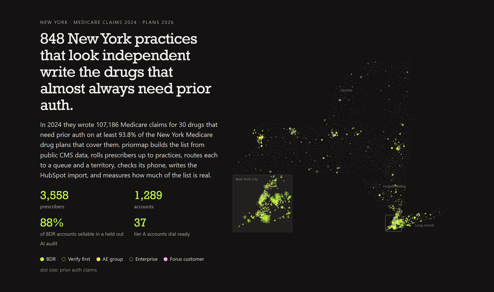

# priormap

**The New York practices that prescribe drugs needing prior auth, found in public CMS data, rolled up from prescribers to practices, routed to the right queue and territory, phone checked, measured for accuracy, and written as a HubSpot import.** Built as a GTM Engineer work sample for [Forus](https://www.forus.com).

**Live card: [codedvibesx.github.io/priormap](https://codedvibesx.github.io/priormap/)** &nbsp; [](https://github.com/CodedVibesX/priormap/actions/workflows/pages.yml) (green only when the tests pass on the committed data and a fresh rebuild matches the committed card, before every deploy)



## The problem

Forus automates prior authorization for specialty practices, and its growth is moving from word of mouth to outbound: a first GTM Engineer, a Business Development Manager with a team of BDRs, a first RevOps hire. The GTM Engineer posting asks for systems for provider research, enrichment, scoring and routing, wired into the CRM (HubSpot, per the BDR and RevOps postings) and the warehouse (BigQuery, per the data posting), with accuracy measured.

The first thing a new BDR team needs is the list: which practices write the drugs that need prior auth, how much, who to call, whether the number in the CRM rings, and how much of the list is real. Forus is in SoHo, so priormap starts with New York.

## Where the list comes from

All public, all federal, no keys:

* **Which drugs.** The drugs Forus names on forus.com and its engineering blog in the specialties it serves (Dupixent, Rinvoq, Cimzia, Skyrizi, Humira, Nurtec, Ubrelvy), plus 28 of the same class in the specialties forus.com lists: rheumatology, dermatology, allergy, gastroenterology, neurology, pulmonology. Each is tied to its source in [src/drugs.ts](src/drugs.ts). Forus also names Zepbound and Wegovy; they are left out on purpose (below).
* **Whether they need prior auth.** CMS's [Prescription Drug Plan Formulary files](https://data.cms.gov/provider-summary-by-type-of-service/medicare-part-d-prescribers/monthly-prescription-drug-plan-formulary-and-pharmacy-network-information) (the September 2026 release, pinned) flag prior auth per drug, per plan. The zip is 2.29 GB, but priormap reads its table of contents and pulls only the three files it needs with HTTP range requests. RxNorm names every drug code. A plan counts as requiring prior auth for a drug only when every version of the drug on its formulary needs it.
* **Who prescribes them.** [Medicare Part D Prescribers by Provider and Drug](https://data.cms.gov/provider-summary-by-type-of-service/medicare-part-d-prescribers/medicare-part-d-prescribers-by-provider-and-drug), 2024, the newest year CMS publishes: claims per prescriber per drug.
* **Where they practice.** The [NPPES NPI Registry](https://npiregistry.cms.hhs.gov/) for each prescriber's address and phone, and Medicare's [Doctors and Clinicians file](https://data.cms.gov/provider-data/dataset/mj5m-pzi6) for the groups each one bills under, their size, and their own addresses and phones.
* **Who is not a private practice.** HRSA's list of [health center sites](https://data.hrsa.gov/data/download) for safety net clinics, and the Census [ZIP to county file](https://www.census.gov/geographies/reference-files/time-series/geo/relationship-files.html) for territories.

## What priormap does with it

```
 35 drugs: 7 Forus names, 28 of the same class
 30 need prior auth on 93.8% to 100% of the New York Medicare plans that cover them (202 plans, 51 formularies)
  5 left out: no New York plan lists them (Taltz, Simponi, Olumiant, Omvoh, Ajovy)

 3,924 New York prescribers in Part D for the 35 drugs
 3,889 for the 30 that count
 3,558 in accounts; 331 skipped: 148 moved (Medicare lists them only outside New York), 53 practice outside
       New York per the registry, 52 residents or fellows, 41 not a practice, 28 audited out, 9 not in the registry
 1,289 accounts, holding 284,801 Medicare claims in 2024
```

**Drug gate.** All 30 drugs that count need prior auth on at least 93.8% of the New York plans that list them; Dupixent, Xolair and Actemra on all 202. The rule is recomputed on every run, never assumed. Zepbound and Wegovy are left out on purpose: Medicare did not cover weight loss in 2024, so those claims are mostly diabetes prescriptions and would point a rep at primary care.

**Prescribers to practices.** A prescriber belongs to a Medicare group (its organization PAC ID) from Medicare's own file: a Medicare row at the address the NPI registry gives when there is one (a group's row first; someone Medicare lists there billing alone stays alone), then a group in the same ZIP, then any group, each choice ranked (the group with the most Medicare rows for them, then the smaller group, then the lower ID), so the same data always routes the same way however the file is ordered. A prescriber who bills alone but lists a group's site and one of the group's phones there joins that group. Anyone else stands alone.

**Five queues, each with its reason written on the record.**

| Queue | Accounts | Prescribers | 2024 PA claims | Rule |
|---|---:|---:|---:|---|
| BDR | 848 | 1,291 | 107,186 | independent: under 50 clinicians, nothing below says system, and listed by Medicare in New York |
| Research: verify first | 179 | 179 | 10,700 | in no Medicare group and missing from Medicare's clinician file |
| AE: multi site group | 42 | 366 | 26,465 | groups of 50 to 299 clinicians: check ownership first |
| Enterprise: health system | 219 | 1,721 | 140,337 | see below |
| Account manager: expansion | 1 | 1 | 113 | practices Forus names as customers |

An account is enterprise when its Medicare group name says hospital, university, faculty practice, health center and the like; when the group has 300 or more clinicians; when at least two, and at least half, of its prescribers also bill under such a group; when its address is a federally funded health center site (same street address and suite, per HRSA), a hospital or medical school address, or a campus where system clinicians outnumber everyone else two to one at the same street address; or when its main line is shared with a hospital and at least one more Medicare group (Memorial Sloan Kettering's "Memorial Neurology Group" and three siblings all list 212 639 2000). Every rule came from reading the output or from an audit, and every reason quotes what matched, so a rep can see why.

Two of them came from the first version getting it wrong. "Allergy Immunology Rheumatology Clinical Group" in Rochester topped the BDR queue; nothing in its name says hospital, but all 13 of its prescribers also bill under the University of Rochester. And a medical office building is not a campus: 1991 Marcus Avenue in Lake Success holds both NYU Langone practices and independents, so a shared address alone never routes anyone.

**Forus's own customer.** The expansion queue holds one account: the neurologist of [Modern Migraine MD](https://www.forus.com/stories/how-modern-migraine-md-enables-providers-to-prescribe-on-clinical-judgement-with-forus), Forus's New York customer story, who prescribes under an individual NPI with no Medicare group. The first version matched customers by group name only, missed the account, and routed Forus's own customer to a cold call queue until a reviewer caught it; the customer list in [data/forus_customers.json](data/forus_customers.json) now also matches by NPI, with the sources for the link.

**Territory.** Each account lands in a region and an area by county, grouped the way New York State groups them (its ten [regional council](https://regionalcouncils.ny.gov) regions): the five boroughs, Nassau and Suffolk, the Mid Hudson counties, and seven upstate regions. The 848 BDR accounts split 445 New York City, 188 upstate, 143 Long Island, 72 Hudson Valley.

**Rank and tier.** Accounts rank by 2024 prior auth claims, overall and inside each queue. Tier A is the accounts that together hold the first half of the queue's claims (54 BDR accounts), B the next 30%, C the rest. 37 of the tier A accounts have a phone both directories agree on: dial ready on day one.

## How accurate the BDR queue is

A list is only as good as the share of it a rep can actually sell to, so priormap measures that instead of claiming it.

**52 of 59 held out BDR accounts are independent practices a BDR can sell to: 88.1% (95% interval 77.5% to 94.1%).** Of the 52, 28 are specialty practices and 24 are primary care or multispecialty practices, which write these drugs too but sit outside the specialties Forus names. Each account counts once; weighted by claims, 92.7% of the sampled claims are at sellable accounts. Sixty accounts were drawn at random from the BDR queue outside the tuning sample, which held the 30 largest BDR accounts, so none of them shaped the rules. The samples are committed in [audit/](audit); [scripts/audit_sample.mts](scripts/audit_sample.mts) drew them with fixed seeds against the routing of October 14, 2026, and a redraw today follows today's rules. Each account was researched from public sources (the practice's own site, health system directories, CMS and NPPES records) by one AI agent, challenged by a second whose job was to refute it, and settled by a third where the two disagreed (5 of the 60). The researchers saw each account's queue and routing reason, and all three are the same model family, so this is an automated audit, not a blind or human one. One account could not be settled and is left out of the count. The seven misses: four are not office practices (two doctors whose Medicare work is in nursing homes, a group that covers nursing homes, and a remote monitoring vendor), two are hospital employed groups under their own legal names, and one has moved. The misses stay in the count: tuning the rules on the held out sample would make the number meaningless.

The rules were tuned on a separate sample first, 95 accounts across the queues, including the 30 largest BDR accounts (24 of those 30 were sellable). As first routed, 55 of 69 BDR accounts in it were sellable (79.7%). The verify first rule it drove took 11 of them out of the BDR queue, 6 of them misses, and the 58 left scored 50 of 58 (86.2%). Since then, every group practice either audit found routed wrong is corrected, citing the audit, in [audit/labels.json](audit/labels.json): 15 accounts. The 88.1% measures the rules before those corrections.

The labels are in [docs/audit_heldout.csv](docs/audit_heldout.csv) and [docs/audit_dev.csv](docs/audit_dev.csv): for each group practice, its label, how it was decided, its queues, and the public pages the researchers cited (practice sites, health system and clinician directories, CMS and NPPES records). The 31 group practices in the held out sample scored 27 of 31 (87.1%). The 28 prescribers who bill alone scored 25 of 28; they are published only as counts by label, and their labels do not go into the public routing. The researchers' written notes are not published, because they discuss individual clinicians. A label is a routing judgment made from public sources, about which queue an account belongs in. Read the number for what it is: AI researchers working from public sources, with no call to any practice; the cited pages are there so anyone can check a label.

## The phone check

A rep's first dial goes to the number in HubSpot, so priormap compares the two federal directories at the same address: the phone the NPI registry lists for the prescriber, and the one Medicare's Doctors and Clinicians file lists for the site.

* Where both list the same site and both list a phone (same ZIP and street number, Queens hyphens folded): 740 accounts.
* They disagree at 157 (21.2%), 90 of them in the BDR queue: 99 different numbers, 38 another line on the same exchange, 3 with two digits swapped, 14 one digit apart, 3 malformed.
* Another 15 Medicare listings run an extension into the phone digits ("5164664700110" is 516 466 4700, extension 110). It is the same number, but no dialer or phone field can use it.

Example, in the BDR queue: New York Neurology Associates PC on Park Avenue. Medicare lists (212) 987 1000; the NPI registry lists (212) 987 0100.

priormap never says which number is right; only a call can. HubSpot's Phone Number gets Medicare's number (the group's listing for the site) unless only the registry's number has a New York area code, and the other goes in `priormap second phone`; `priormap phone check` says how they differ. The check is made by the prescriber at the site whose comparison has two numbers to compare, against the account's own Medicare group listing there first; a member Medicare lists nowhere (an attached PA or MD) is compared against the group's listing. A number that breaks the North American plan (an area code or exchange starting with 0 or 1) is malformed, never exported.

**Tested, and the test found a bug.** Its first run showed that on 4 accounts the number exported to HubSpot was not the number the check had compared; that is fixed. The test borrows the perturbation idea Forus's engineering blog [describes for its LLM judge](https://build.forus.com/how-we-evaluate-our-llm-judge-a-perturbation-based-approach); on phone digits it tests the plumbing only. `npm run eval` takes the 568 accounts where the two directories agree, corrupts Medicare's number five ways (one digit, a swap, the area code, a new line, a dropped digit) everywhere Medicare prints it for that group, reruns the whole engine, and reads each account's check: 2,840 corruptions, of which 2,830 surface as a disagreement a rep would see. The 10 that do not are two accounts where the corrupted number was also what tied a prescriber with no Medicare row to the group: when it changed, that prescriber left the account, and the listings left had nothing to compare. Alongside them run 1,136 controls that must not be flagged: the same numbers untouched, and the same numbers rewritten with a +1, parentheses or dots. 0 were flagged. The untouched half can only fail if the eval itself is broken; the reformatted half tests the number parser. How often a flagged disagreement is a dead line in real life takes dials; the `priormap phone check` property is there so RevOps can report it from HubSpot after the first week of calls.

## What a growth team gets

`npm start` writes, from the committed snapshots, in seconds:

* `leads/hubspot_companies.csv`: one row per account. HubSpot's stock company properties first (Company name, Phone Number, address, Industry `Medical Practice`, Lifecycle Stage `lead`), then priormap's: practice id, queue, the reason for the queue, territory, rank, tier, 2024 prior auth claims, prescribers, Medicare group size, top drugs, specialties, phone check, second phone, fax, and a talking point built only from the account's own numbers. For the top BDR account: "3 prescribers here wrote 3,401 Medicare claims in 2024 for 5 drugs that need prior auth on most New York plans that cover them, led by Nurtec ODT (1,393) and Emgality (665)." The top 25 BDR rows are committed in [docs/sample_hubspot_companies.csv](docs/sample_hubspot_companies.csv).
* `leads/hubspot_contacts.csv`: one row per prescriber (name, specialty and credential as Job Title, Lead Status `NEW`), with NPI, claims and drugs, and the `priormap practice id` that associates each contact with its company when both files are imported together.
* `leads/practices.csv` and `leads/prescribers.csv`: snake case columns, plain numbers, one row per account and per prescriber, ready to load into BigQuery.
* `leads/phone_check.csv`: every account where the directories disagree.
* `leads/skipped.csv`: every prescriber left out, with the reason.
* `app/card.json`: the numbers behind the card, computed by the run.

Accounts carry a stable id (`org:` plus the Medicare organization PAC ID, or `npi:` for a prescriber alone), so a rerun updates records instead of duplicating them: set `priormap practice id` and `priormap npi` to require unique values in HubSpot.

## Built to rerun

```
npm run fetch    # every source, from its federal API or file
npm start        # build, export, eval
```

Medicare's clinician file refreshes monthly and the NPI registry weekly; a fetch pulls their current versions. Part D is pinned to its 2024 version and the formulary to its September 2026 release, so a rerun reads the same years until they are moved on purpose. The formulary, county and health center fetches check the columns they read, and the county fetch refuses to overwrite its snapshot when the result looks too small; the Part D, NPI registry and Medicare clinician pulls do not check yet, so read a fetch's log before committing its snapshot. New York is built in: other states would need their counties, regions and PDP region mapped first.

## Read before quoting

* Medicare is a floor. Part D sees only Medicare patients, and CMS hides any drug a prescriber wrote fewer than 11 times.
* Claims are not prior auth requests. One approval usually covers months of refills, so requests run well below claims.
* The claims are from 2024; the prior auth flags are from the plans sold in 2026.
* Part D covers drugs a pharmacy dispenses. Drugs given in the office or by infusion and billed to Part B (Xolair, or Entyvio and Orencia by infusion) are not in these claims, though Medicare Advantage plans require prior auth on them too.
* Ranking by Medicare claims favors specialties with older patients (rheumatology, neurology) over dermatology and allergy, where Forus has most of its published stories.
* The AE queue needs an ownership check before anyone calls: in the tuning sample, 4 of 10 groups of 50 to 299 clinicians were physician groups, 5 were hospital employed practices filed under their own legal names (4 of them with nothing in these files to give it away; the switchboard rule now routes the fifth, Memorial Neurology Group, to Enterprise), and 1 was not a practice.
* Doctors and groups whose Medicare work is in nursing homes look like office practices in these files; they are the largest kind of miss in the held out audit (3 of 7).

## The card


A static Next.js page in Forus's own palette, read from forus.com's stylesheet. One animation: every account with a mapped ZIP lights up on the map of New York in rank order, colored by its queue.

## Run it

```
npm install
npm start          # build, export and eval from the committed snapshots
npm test           # unit tests, end to end fixtures, and invariants on the real data
npm run eval       # the phone check eval on its own
npm run dev        # the card on http://localhost:3008
npm run shots      # screenshots, plus checks for dashes, phone overflow and console errors (CHROME_PATH off Windows)
```

Node 22.12 or newer (the screenshot tool needs it; Next.js 16 needs 20.9). The engine is TypeScript in `src/`, run with tsx. No API keys: every source is public. MIT licensed.

## Data

CMS Medicare Part D Prescribers by Provider and Drug (2024); CMS Prescription Drug Plan Formulary, Pharmacy Network and Pricing Information (September 2026), used under the CMS data use agreement; NPPES NPI Registry API; Medicare Doctors and Clinicians National Downloadable File (modified August 18, 2026); HRSA Health Center Service Delivery Sites; Census 2020 ZCTA to County Relationship File; NLM RxNorm (RxNav API); Census 2024 Gazetteer ZIP Code Tabulation Areas (for the map only).

Built by Larry Wolters. Not affiliated with Forus.
